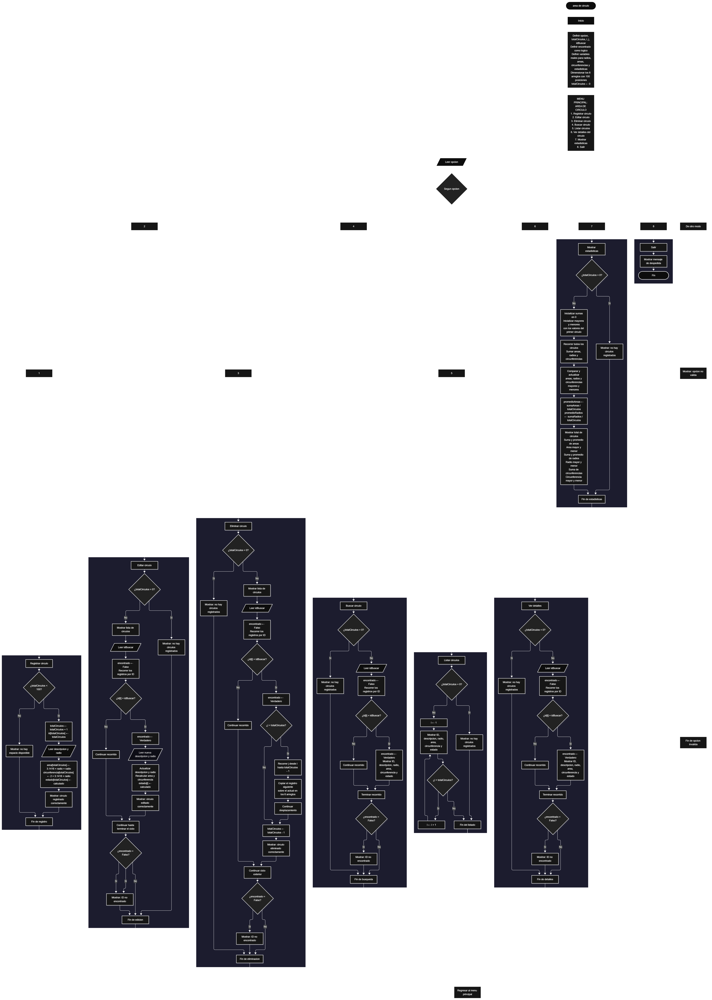

 

Este proyecto, llamado <b>área de círculo</b>, fue desarrollado en <b>pseint</b> como un ejercicio práctico para fortalecer la lógica de programación mediante la creación de un sistema de gestión de círculos desde la consola. El programa cuenta con un menú principal de ocho opciones que permite <b>registrar, editar, eliminar, buscar, listar y consultar los detalles</b> de los círculos almacenados, además de generar estadísticas generales sobre sus propiedades geométricas. Cada círculo almacena información como su identificador, descripción, radio, área, circunferencia y estado, utilizando arreglos con una capacidad máxima de <b>100 círculos durante la ejecución</b>. El área y la circunferencia se calculan automáticamente a partir del radio ingresado. Durante su desarrollo se aplicaron conceptos fundamentales de programación, como variables, arreglos, estructuras condicionales, ciclos repetitivos, estructuras de selección, operaciones matemáticas y procedimientos para buscar, modificar, eliminar y organizar registros. Este proyecto permite poner en práctica los conocimientos adquiridos en pseint mediante la combinación de operaciones geométricas y herramientas básicas de gestión de información.

<h2 align="center">⚙️ Funcionamiento del menú principal</h2>

### ➕ Registrar círculo

La opción <b>1) registrar círculo</b> permite agregar un nuevo círculo al sistema. Antes de realizar el registro, el programa comprueba que la cantidad de círculos almacenados sea menor a <b>100</b>, utilizando la condición <b>totalCirculos &lt; 100</b>. Si existe espacio disponible, la variable <b>totalCirculos</b> aumenta en uno y se asigna un identificador mediante la instrucción <b>id[totalCirculos] &lt;- totalCirculos</b>. Después, el programa solicita la <b>descripción y el radio</b> del círculo. Con el radio ingresado, calcula automáticamente el área mediante la fórmula <b>3.1416 × radio × radio</b> y la circunferencia mediante la fórmula <b>2 × 3.1416 × radio</b>. Finalmente, asigna el estado <b>"calculado"</b> y muestra el mensaje <b>"círculo registrado correctamente."</b>. Si se alcanza la capacidad máxima, presenta el mensaje <b>"no hay espacio para registrar más círculos."</b>, impidiendo registrar otro círculo.

### ✏️ Editar círculo

La opción <b>2) editar círculo</b> permite modificar los datos de un círculo registrado. Primero, el programa comprueba si existen círculos almacenados mediante la variable <b>totalCirculos</b>. Si no hay registros, muestra el mensaje <b>"no hay círculos registrados."</b>. En caso contrario, presenta una lista con el identificador, la descripción, el radio, el área, la circunferencia y el estado de cada círculo. Después, solicita el identificador del círculo que se desea editar e inicializa la variable lógica <b>encontrado</b> con el valor <b>falso</b>. Mediante un ciclo <b>para</b>, recorre los identificadores hasta encontrar una coincidencia. Si encuentra el círculo, permite ingresar una nueva descripción y un nuevo radio. A continuación, recalcula el área y la circunferencia y actualiza el estado a <b>"calculado"</b>. Finalmente, muestra el mensaje <b>"círculo editado correctamente."</b>. Si no encuentra el identificador, presenta el mensaje <b>"no se encontró un círculo con ese id."</b>.

### 🗑️ Eliminar círculo

La opción <b>3) eliminar círculo</b> permite eliminar un círculo registrado mediante su identificador. Antes de comenzar, el programa comprueba si existen círculos almacenados. Si no hay registros, muestra el mensaje <b>"no hay círculos registrados."</b>. Si existen círculos, presenta sus datos y solicita el identificador que se desea eliminar. Después, inicializa la variable <b>encontrado</b> con el valor <b>falso</b> y utiliza un ciclo <b>para</b> para buscar el registro correspondiente. Cuando encuentra una coincidencia, cambia la variable a <b>verdadero</b>. Si el círculo no ocupa la última posición, utiliza un ciclo controlado por la variable <b>j</b> para desplazar una posición hacia atrás los valores de los arreglos <b>id, descripcion, radio, area, circunferencia y estado</b>. Posteriormente, disminuye la variable <b>totalCirculos</b> en uno y muestra el mensaje <b>"círculo eliminado correctamente."</b>. Si no encuentra el identificador, presenta el mensaje <b>"no se encontró un círculo con ese id."</b>. El código no limpia explícitamente la última posición del arreglo después de la eliminación.

### 🔎 Buscar círculo

La opción <b>4) buscar círculo</b> permite localizar un círculo mediante su identificador. Primero, el programa comprueba si existen registros almacenados. Si el total de círculos es igual a cero, muestra el mensaje <b>"no hay círculos registrados."</b>. En caso contrario, solicita el identificador del círculo que se desea buscar e inicializa la variable lógica <b>encontrado</b> con el valor <b>falso</b>. A continuación, utiliza un ciclo <b>para</b> para recorrer los identificadores almacenados y compararlos con el valor introducido mediante la condición <b>id[i] = idBuscar</b>. Cuando encuentra una coincidencia, cambia la variable <b>encontrado</b> a <b>verdadero</b> y muestra los datos del círculo: identificador, descripción, radio, área, circunferencia y estado. Si termina el recorrido sin encontrar coincidencias, presenta el mensaje <b>"no se encontró un círculo con ese id."</b>.

### 📋 Listar círculos

La opción <b>5) listar círculos</b> permite visualizar todos los círculos registrados actualmente. Antes de mostrar la información, el programa comprueba si la variable <b>totalCirculos</b> es igual a cero. Si no existen registros, presenta el mensaje <b>"no hay círculos registrados."</b>. Si hay círculos disponibles, utiliza un ciclo <b>para</b> para recorrer los arreglos desde la primera posición hasta el total de registros. Durante el recorrido, muestra el identificador, la descripción, el radio, el área, la circunferencia y el estado de cada círculo. Esta función facilita consultar todos los registros sin necesidad de buscarlos individualmente.

### 📄 Ver detalles del círculo

La opción <b>6) ver detalles del círculo</b> permite consultar individualmente la información de un círculo específico. Primero, el programa comprueba si existen círculos registrados. Si no hay registros, muestra el mensaje <b>"no hay círculos registrados."</b>. En caso contrario, solicita el identificador del círculo que se desea consultar e inicializa la variable <b>encontrado</b> con el valor <b>falso</b>. Después, utiliza un ciclo <b>para</b> para recorrer los identificadores y localizar el registro solicitado. Si encuentra una coincidencia, cambia la variable a <b>verdadero</b> y presenta cada dato por separado: <b>id, descripción, radio, área, circunferencia y estado</b>. Si el identificador no corresponde a ningún círculo registrado, muestra el mensaje <b>"no se encontró un círculo con ese id."</b>.

### 📊 Mostrar estadísticas

La opción <b>7) mostrar estadísticas</b> permite analizar los valores geométricos de los círculos registrados. Primero, el programa comprueba si existen registros. Si la cantidad de círculos es igual a cero, muestra el mensaje <b>"no hay círculos registrados."</b>. En caso contrario, inicializa las variables <b>sumaAreas, sumaRadios y sumaCircunferencias</b> en cero. También establece los valores iniciales de las variables de mayor y menor área, radio y circunferencia utilizando los datos del primer círculo. Después, recorre los registros mediante un ciclo <b>para</b>, acumula las sumas y compara los valores para determinar los máximos y mínimos. Finalmente, calcula el promedio de las áreas mediante <b>sumaAreas / totalCirculos</b> y el promedio de los radios mediante <b>sumaRadios / totalCirculos</b>. El programa presenta el total de círculos, las sumas, los promedios disponibles y los valores mayores y menores de cada propiedad. Aunque calcula la suma de las circunferencias, el código no calcula su promedio.

### 🚪 Salir del menú principal

La opción <b>8) salir</b> está destinada a finalizar la ejecución del programa y muestra el mensaje <b>"gracias por utilizar area de circulo."</b>. El menú principal se encuentra dentro de una estructura repetitiva <b>repetir ... hasta que</b>, cuya condición final es <b>hasta que opcion = 8</b>. Por lo tanto, al seleccionar la opción 8, se cumple la condición de salida y termina el ciclo del menú principal.

<h2 align="center">🧠 Temas aplicados en el proyecto</h2>

### 📦 Variables

En este proyecto se utilizan variables de tipo entero, real y lógico para controlar las opciones del menú, contar los círculos registrados, recorrer los arreglos, identificar los registros que se desean modificar o consultar, efectuar los cálculos geométricos y almacenar los resultados estadísticos. Cada variable cumple una función específica dentro de las operaciones del programa.

🔢 **Opcion:** Almacena la opción seleccionada por el usuario en el menú principal.

📊 **TotalCirculos:** Controla la cantidad actual de círculos registrados.

🔄 **I:** Funciona como contador en los ciclos que recorren los registros.

🔁 **J:** Controla el desplazamiento de los datos durante la eliminación de un círculo.

🔎 **IdBuscar:** Almacena el identificador introducido para buscar, editar, eliminar o consultar un círculo.

✅ **Encontrado:** Variable lógica que indica si se localizó el identificador solicitado.

📐 **Radio:** Almacena el radio de cada círculo.

📏 **Area:** Guarda el área calculada a partir del radio.

⭕ **Circunferencia:** Guarda la circunferencia calculada a partir del radio.

📝 **Descripcion:** Almacena la descripción de cada círculo.

📌 **Estado:** Guarda el estado asignado al círculo, cuyo valor es <b>"calculado"</b> al registrarlo o editarlo.

📊 **SumaAreas, SumaRadios y SumaCircunferencias:** Acumulan los valores de las respectivas propiedades geométricas.

📈 **PromedioAreas y PromedioRadios:** Almacenan los promedios del área y del radio.

🔺 **MayorArea, MayorRadio y MayorCircunferencia:** Guardan los valores máximos encontrados.

🔻 **MenorArea, MenorRadio y MenorCircunferencia:** Guardan los valores mínimos encontrados.

### 🗃️ Arreglos

En este proyecto se utilizan seis arreglos relacionados con los datos de cada círculo. Cada arreglo tiene una capacidad de <b>100 posiciones</b> y utiliza el mismo índice para representar la información correspondiente a un mismo registro. Por ejemplo, los datos del círculo almacenado en la posición <b>1</b> se encuentran distribuidos entre <b>id[1], descripcion[1], radio[1], area[1], circunferencia[1] y estado[1]</b>. Esta organización permite recorrer, buscar, modificar, mostrar y eliminar los círculos mediante sus posiciones correspondientes.

🆔 **Id[100]:** Almacena los identificadores de los círculos registrados.

📝 **Descripcion[100]:** Almacena las descripciones de los círculos.

📐 **Radio[100]:** Guarda los radios ingresados por el usuario.

📏 **Area[100]:** Almacena las áreas calculadas.

⭕ **Circunferencia[100]:** Almacena las circunferencias calculadas.

📌 **Estado[100]:** Guarda el estado de cada círculo.

### 🔀 Estructuras condicionales

En este proyecto se utilizan las estructuras <b>si</b> y <b>sino</b> para comprobar si existe espacio antes de registrar un círculo, verificar si hay registros antes de realizar determinadas operaciones, comprobar si un identificador coincide con alguno de los almacenados y determinar si es necesario desplazar los datos durante una eliminación. También se utilizan condiciones para comparar las áreas, los radios y las circunferencias, permitiendo identificar sus valores mayores y menores durante el cálculo de estadísticas.

### 🔄 Estructuras repetitivas

En este proyecto se utilizan los ciclos <b>para</b> y <b>repetir ... hasta que</b>. Los ciclos <b>para</b> permiten recorrer los arreglos para listar los círculos, buscar identificadores, mostrar detalles, editar registros y calcular estadísticas. Durante la eliminación, también se utiliza un ciclo para desplazar los datos de las posiciones posteriores. Por otro lado, el ciclo <b>repetir ... hasta que</b> mantiene activo el menú principal hasta que el usuario selecciona la opción <b>8</b>.

### 🎯 Estructura según

El programa evalúa el valor almacenado en la variable <b>opcion</b> y ejecuta el bloque de instrucciones correspondiente mediante la estructura <b>segun opcion hacer</b>. Cada caso representa una operación específica: <b>registrar, editar, eliminar, buscar, listar, ver detalles, mostrar estadísticas o salir</b>. También se utiliza el bloque <b>de otro modo</b> para mostrar el mensaje <b>"opcion no valida."</b> cuando el usuario introduce un número que no corresponde a ninguna de las opciones definidas.

### 🔢 Dimensionamiento de arreglos

El programa utiliza la instrucción <b>dimension</b> para establecer la capacidad de los seis arreglos que almacenan los datos de los círculos. Cada uno dispone de <b>100 posiciones</b>, lo que permite administrar hasta 100 círculos registrados simultáneamente. La cantidad de posiciones activas se controla mediante la variable <b>totalCirculos</b>, por lo que los recorridos utilizan las posiciones comprendidas entre la primera y el total actual de registros.

### 🧮 Cálculos geométricos

El programa aplica fórmulas matemáticas para calcular las propiedades geométricas de cada círculo a partir del radio ingresado. Para el área utiliza la fórmula <b>A = π × r²</b>, implementada con el valor aproximado <b>3.1416</b>. Para la circunferencia utiliza la fórmula <b>C = 2 × π × r</b>, también utilizando <b>3.1416</b> como aproximación de pi. Estos cálculos se realizan durante el registro y se repiten cuando el usuario modifica el radio de un círculo.

📐 **Área:** Se calcula multiplicando 3.1416 por el radio y nuevamente por el radio.

⭕ **Circunferencia:** Se calcula multiplicando 2 por 3.1416 y por el radio.

### 📊 Operaciones estadísticas

La opción de estadísticas utiliza variables reales para acumular los valores de las áreas, los radios y las circunferencias. Durante el recorrido, compara cada valor con los máximos y mínimos almacenados para actualizar los resultados cuando encuentra uno mayor o menor. Al finalizar, divide la suma de las áreas y la suma de los radios entre la cantidad de círculos registrados para obtener sus respectivos promedios. Las circunferencias cuentan con suma, máximo y mínimo, pero no con un promedio implementado en el código actual.

### 🔄 Reorganización de registros

Cuando se elimina un círculo, el programa desplaza los datos de los registros posteriores una posición hacia atrás en los seis arreglos. Este procedimiento se realiza mediante el ciclo <b>para</b> controlado por la variable <b>j</b>, que copia los valores de la posición siguiente sobre la posición actual. Después, la variable <b>totalCirculos</b> disminuye en uno. El código no limpia explícitamente la última posición ni interrumpe el ciclo exterior después de encontrar el identificador, aspectos que forman parte del comportamiento actual del algoritmo.

<h2 align="center">¿Cómo se implementaron las operaciones crud en el proyecto?</h2>

Las operaciones <b>crud</b> se implementaron mediante las opciones del menú principal para administrar los círculos registrados. La operación <b>crear</b> corresponde a <b>registrar círculo</b>, donde se ingresan la descripción y el radio, y se calculan el área y la circunferencia. La operación <b>leer</b> se realiza mediante las opciones <b>buscar círculo, listar círculos y ver detalles del círculo</b>. La operación <b>actualizar</b> corresponde a <b>editar círculo</b>, que permite cambiar la descripción y el radio y recalcular sus propiedades geométricas. Finalmente, la operación <b>eliminar</b> permite retirar un círculo mediante su identificador y reorganizar los datos almacenados en los arreglos. Toda la información se mantiene temporalmente durante la ejecución del programa.

<h2 align="center">Diagrama de flujo del proyecto</h2>

<h2 align="center">🛡️ Validaciones del programa</h2>

### 📭 No existen círculos registrados

Esta comprobación se utiliza en las opciones de <b>editar, eliminar, buscar, listar, ver detalles y mostrar estadísticas</b>. El programa comprueba si la variable <b>totalCirculos</b> es igual a <b>0</b> y, si no existen círculos registrados, muestra el mensaje <b>"no hay circulos registrados."</b>. Esta condición evita ejecutar los recorridos y los cálculos estadísticos cuando no hay registros activos.

### ⚠️ Capacidad máxima alcanzada

Esta comprobación se utiliza durante el registro de círculos. El programa verifica si <b>totalCirculos &lt; 100</b> antes de agregar un nuevo registro. Si existe espacio disponible, aumenta el contador y solicita los datos correspondientes. Si se alcanza la capacidad máxima, muestra el mensaje <b>"no hay espacio para registrar mas circulos."</b> y no permite agregar otro registro.

### ❌ Círculo no encontrado

Esta comprobación se utiliza durante las operaciones de edición, eliminación, búsqueda y consulta de detalles. El programa inicializa la variable lógica <b>encontrado</b> con el valor <b>falso</b> y recorre los identificadores almacenados para buscar una coincidencia con el valor de <b>idBuscar</b>. Cuando encuentra el registro, cambia la variable a <b>verdadero</b> y ejecuta la operación correspondiente. Si termina el recorrido sin encontrarlo, muestra el mensaje <b>"no se encontro un circulo con ese id."</b>.

### 📐 Cálculo automático de las propiedades geométricas

Al registrar o editar un círculo, el programa calcula automáticamente el área y la circunferencia utilizando el radio ingresado. Sin embargo, el código actual no valida que el radio sea positivo ni impide introducir el valor cero o un número negativo. Por lo tanto, no existe una comprobación explícita que garantice que los radios introducidos correspondan a círculos con dimensiones positivas.

### 🆔 Identificadores de los círculos

El identificador se asigna utilizando el valor actual de <b>totalCirculos</b>. Como este contador disminuye al eliminar registros y vuelve a incrementarse al registrar nuevos círculos, el sistema puede reutilizar identificadores que se hayan asignado anteriormente. El código no utiliza un contador independiente que garantice que cada identificador sea único durante toda la ejecución.

### ⚠️ Opción inválida

La estructura <b>segun</b> incluye el bloque <b>de otro modo</b>, que muestra el mensaje <b>"opcion no valida."</b> cuando el valor introducido no coincide con las opciones del menú. Las opciones válidas están comprendidas entre <b>1 y 8</b>, donde la opción <b>8</b> permite salir del programa.

### 💾 Almacenamiento temporal

Los datos de los círculos se guardan en arreglos durante la ejecución del algoritmo. El código no utiliza archivos, bases de datos ni mecanismos de persistencia para conservar los registros después de finalizar el programa. Por esta razón, la información almacenada se pierde al terminar la ejecución.

<h2 align="center">🎯 Objetivo del proyecto</h2>

El objetivo principal de este proyecto es fortalecer la <b>lógica de programación</b> mediante el desarrollo de un sistema de gestión de círculos en <b>pseint</b>. A través de su construcción se busca aplicar los conocimientos adquiridos sobre variables, arreglos, estructuras condicionales, ciclos repetitivos, estructuras de selección y operaciones matemáticas, integrándolos para resolver un problema de manera organizada. Además, el proyecto permite comprender cómo registrar, consultar, modificar y eliminar información, calcular propiedades geométricas y obtener estadísticas descriptivas a partir de un conjunto de datos. De esta manera, establece una base para desarrollar sistemas de cálculo y gestión más completos utilizando otros lenguajes y tecnologías.

